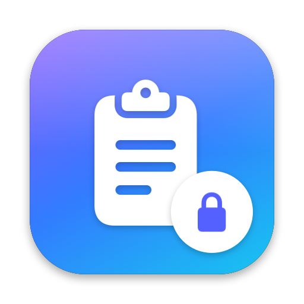
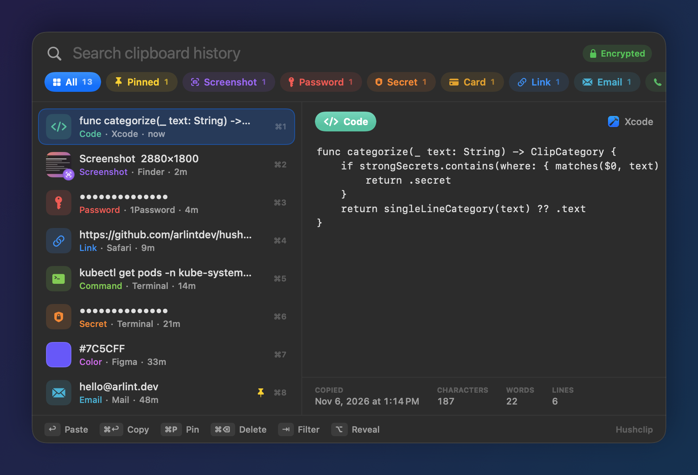
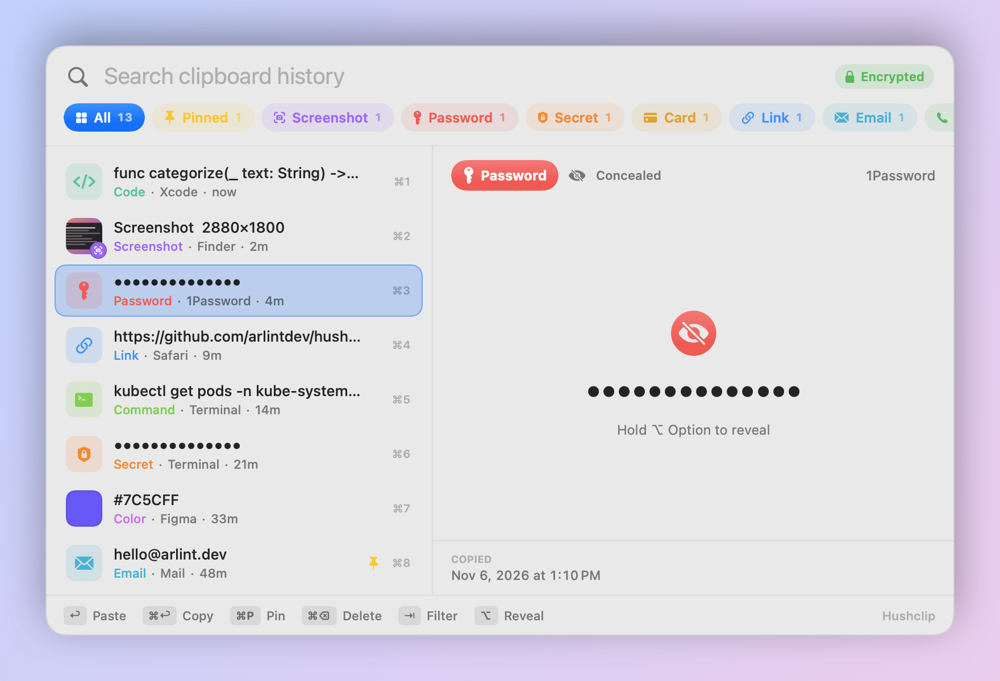

<p align="center">
  
</p>

<h1 align="center">Hushclip</h1>

<p align="center">
  <b>An encrypted clipboard history for macOS.</b><br>
  Press <kbd>⌘</kbd><kbd>⇧</kbd><kbd>V</kbd> anywhere to search, preview and paste everything you've copied,
  sorted into categories automatically.
</p>

<p align="center"><sub>Hushclip was called <b>Clipster</b> before version 1.1. Your history carries over automatically.</sub></p>

<p align="center">
  <a href="https://github.com/arlintdev/hushclip/releases/latest"></a>
  <a href="https://github.com/arlintdev/hushclip/actions/workflows/ci.yml"></a>
  
  
</p>

<p align="center">
  
</p>

## Features

- **Global overlay on ⌘⇧V.** A floating panel opens over whatever you're doing. Type to search, use arrow keys to pick, press Return to paste straight into the app you were in.
- **Automatic categories.** Every clip is labelled by local regex and heuristic rules. There's no network access and no AI.
- **Encrypted at rest.** History and images are sealed with **AES-256-GCM** (CryptoKit). The 256-bit key is generated on your Mac and kept in your login Keychain as this-device-only. Nothing is ever written to disk in plaintext.
- **Touch ID lock.** Optionally lock your history until you unlock it with Touch ID (or your Mac password). Choose when it locks: when the screen locks or the Mac sleeps, or after 15 minutes to 12 hours without use. While locked, the decrypted history and its key are cleared from memory, and new clips are still recorded, sealed so that only an unlock can read them.
- **Quick actions.** Each kind of clip gets its own shortcuts: open a link (<kbd>⌘O</kbd>) or paste it without tracking parameters or as Markdown, call a phone number, paste a color as HEX/RGB/HSL/SwiftUI, pretty-print or minify JSON, show a path in Finder, or paste the text from a screenshot (recognized on-device). <kbd>⌘K</kbd> lists them all.
- **Full-screen preview.** Click an image or press <kbd>Space</kbd> to see the selected clip full screen. Pinch to zoom into screenshots, and flip through clips with the arrow keys.
- **Careful with secrets.** Passwords, API keys and card numbers are masked in the UI (hold <kbd>⌥</kbd> to reveal) and auto-deleted after an hour by default. Hushclip follows the [nspasteboard.org](http://nspasteboard.org) conventions: it skips *transient* items and labels *concealed* items from password managers as passwords (or skips them entirely, if you choose).
- **Native and light.** Swift + AppKit + SwiftUI, one universal binary, runs only in the menu bar, no dependencies.

### Categories

| Category | How it's detected |
|---|---|
| 📸 **Screenshot** | A bare image with no other pasteboard data (what the system screenshot tool produces), an image from a screenshot app, or a copied `Screenshot …png` file |
| 🖼 **Image** / 📄 **File** | Images copied from apps or the web; files copied in Finder |
| 🔑 **Password** | Marked concealed by a password manager, or a single token mixing letters, digits and symbols (or 14+ high-entropy characters) |
| 🛡 **Secret** | AWS / GitHub / GitLab / Slack / Stripe / Google / OpenAI / Anthropic / npm / SendGrid keys, JWTs, `-----BEGIN … PRIVATE KEY-----`, `API_KEY=…` lines, long high-entropy tokens |
| 💳 **Card** | 13–19 digits that pass the Luhn check |
| 🔗 **Link** · ✉️ **Email** · 📞 **Phone** · 🌐 **IP Address** | URLs, email addresses, phone numbers (not dates), IPv4/IPv6 with optional CIDR or port |
| 🎨 **Color** | `#hex`, `rgb()`, `hsl()`, `oklch()` and similar, shown with a live swatch |
| 🔢 **UUID** · **Hash** · **Number** · **JSON** | Exact formats; JSON must actually parse |
| ⌨️ **Command** | Shell commands (`git`, `kubectl`, `brew`, `$ …`, …) |
| 🧩 **Code** | Scored on signals like declarations, braces, semicolons, imports, SQL, HTML and indentation |
| 📁 **Path** | `/…`, `~/…`, `./…`, `C:\…` |
| 📝 **Text** | Everything else |

The rules live in [`Sources/HushclipCore/Categorizer.swift`](Sources/HushclipCore/Categorizer.swift) and are unit-tested in [`Tests/HushclipCoreTests`](Tests/HushclipCoreTests). PRs for new formats are welcome.

### Keyboard

| Key | Action |
|---|---|
| <kbd>⌘</kbd><kbd>⇧</kbd><kbd>V</kbd> | Open or close Hushclip |
| <kbd>↑</kbd> <kbd>↓</kbd> | Move the selection |
| <kbd>↩</kbd> | Paste into the active app |
| <kbd>⌘</kbd><kbd>↩</kbd> | Copy to the clipboard without pasting |
| <kbd>⌘</kbd><kbd>1</kbd>…<kbd>9</kbd> | Paste the Nth item |
| <kbd>⇥</kbd> / <kbd>⇧</kbd><kbd>⇥</kbd> | Next / previous category filter |
| <kbd>⌘</kbd><kbd>P</kbd> | Pin or unpin (pinned items never expire) |
| <kbd>⌘</kbd><kbd>⌫</kbd> | Delete the item |
| hold <kbd>⌥</kbd> | Reveal masked passwords and secrets |
| <kbd>Esc</kbd> | Clear the search, then the filter, then close |
| <kbd>⌘</kbd><kbd>,</kbd> | Settings |

<p align="center">
  
</p>

## Install

**Mac App Store:** search for **Hushclip – Clipboard History** (coming soon).

**Direct download:**

1. Download **`Hushclip-x.y.z.dmg`** from the [latest release](https://github.com/arlintdev/hushclip/releases/latest). Releases are signed with a Developer ID and notarized by Apple.
2. Drag **Hushclip** into **Applications** and open it. A clipboard icon appears in the menu bar.
3. Press <kbd>⌘</kbd><kbd>⇧</kbd><kbd>V</kbd>.

The two versions are the same app. The App Store version runs in the App Sandbox, so its data lives in `~/Library/Containers/dev.arlint.clipster/` instead of the folder below.

**Auto-paste** needs Accessibility permission so Hushclip can press <kbd>⌘</kbd><kbd>V</kbd> for you. Hushclip asks the first time you paste. Until you grant it, choosing an item copies it and you paste yourself. You can grant it under **System Settings → Privacy & Security → Accessibility**.

> Note: ⌘⇧V is a global shortcut, so it replaces "Paste and Match Style" in apps that use it. Hushclip always pastes plain text for text items, so you get the same result.

## Security model

| | |
|---|---|
| **At rest** | `~/Library/Application Support/Hushclip/history.vault` (index and text) plus `blobs/*.vault` (images). Each file is `CLIPSTR1` ‖ AES-256-GCM nonce ‖ ciphertext ‖ tag, with the header bound as associated data. The folder is `0700` and the files are `0600`. |
| **Key** | 256 random bits, stored in the login Keychain as a generic password (`dev.arlint.clipster` / `vault-key`), `WhenUnlockedThisDeviceOnly`, never synced. |
| **In memory** | History is decrypted into memory while Hushclip is unlocked. |
| **Lock (optional)** | Unlocking uses LocalAuthentication (Touch ID, Apple Watch or the login password). Locking saves the vault, then drops the decrypted history and the vault key from memory. Clips copied while locked are sealed with HPKE (X25519, HKDF-SHA256, ChaCha20-Poly1305) to an inbox public key in `inbox.pub`, and written to `inbox/*.sealed`. The matching private key is stored only inside the encrypted vault, so locked clips can be read only after unlocking. Hushclip always starts locked when the lock is on. |
| **Sensitive items** | Masked in the UI, excluded from content search when concealed, and deleted after 5 min to 1 week (default 1 hour). When Hushclip pastes them back, it marks them `ConcealedType` so other clipboard tools don't record them. |
| **Network** | None. Hushclip makes no network requests. |
| **Unreadable vault** | If the vault can't be decrypted (for example, the Keychain item was deleted), Hushclip moves it aside instead of overwriting it. |

To wipe everything, use **Clear History…** in the menu, or quit Hushclip and delete the data folder and the Keychain item. (The bundle ID and Keychain service keep the original `clipster` name so existing histories stay readable.)

```bash
rm -rf ~/Library/Application\ Support/Hushclip
```

```bash
security delete-generic-password -s dev.arlint.clipster -a vault-key
```

## Build from source

Requires Xcode 16+ (Swift 5.9+) on macOS 14+.

```bash
git clone https://github.com/arlintdev/hushclip && cd hushclip
```

```bash
swift test
```

```bash
./Scripts/build-app.sh && open build/Hushclip.app
```

`build-app.sh` makes a universal, ad-hoc-signed `build/Hushclip.app`. Set `SIGN_ID="Developer ID Application: …"` to sign with your own identity, or `ARCHS=arm64` for a faster single-arch build. `Scripts/package.sh <version>` produces the `.dmg`, `.zip` and `SHA256SUMS.txt` in `dist/`.

To preview the UI without installing anything, `Hushclip --snapshot out.png [--light] [--select N] [--reveal]` renders the overlay with sample data to a PNG. It runs in memory only and never touches your vault.

### Project layout

```
Sources/HushclipCore/   categorizer, model, AES-GCM vault, Keychain key: pure and unit-tested
Sources/Hushclip/       menu bar app: pasteboard monitor, Carbon hotkey, overlay panel, SwiftUI views
Scripts/                build-app.sh, package.sh, make-icon.swift, make-appstore-screenshots.swift
project.yml             Xcode project spec for the sandboxed Mac App Store build (xcodegen)
.github/workflows/      ci.yml (test + build on every push/PR), release.yml (tag → GitHub Release)
```

## Releasing

Push a version tag:

```bash
git tag v1.1.1 && git push origin v1.1.1
```

[`release.yml`](.github/workflows/release.yml) runs the tests, builds a universal app, packages the `.dmg` and `.zip`, and publishes a GitHub Release. Release notes come from `docs/releases/<tag>.md` if that file exists; otherwise they're generated.

Releases are **signed and notarized** when these repository secrets are set: `MACOS_CERT_P12` (base64 Developer ID Application .p12), `MACOS_CERT_PASSWORD`, and an App Store Connect API key for `notarytool` (`APPSTORE_API_KEY_P8` as base64, `APPSTORE_API_KEY_ID`, `APPSTORE_API_ISSUER_ID`). Without them the workflow falls back to ad-hoc signing, and users have to click **Open Anyway** in **System Settings → Privacy & Security** on first launch.

### Mac App Store

The App Store build is made from [`project.yml`](project.yml) (run `xcodegen generate` after changing it), which adds the App Sandbox entitlement and an asset-catalog icon:

```bash
xcodebuild archive -project Hushclip.xcodeproj -scheme Hushclip -archivePath build/Hushclip.xcarchive -allowProvisioningUpdates
```

Then export it with `xcodebuild -exportArchive` and an `ExportOptions.plist` using `method` `app-store-connect`. Store screenshots are generated by `swift Scripts/make-appstore-screenshots.swift <Hushclip binary> docs/appstore`, and the icon by `swift Scripts/make-icon.swift`.

## License

[MIT](LICENSE) © 2026 Austin Arlint
